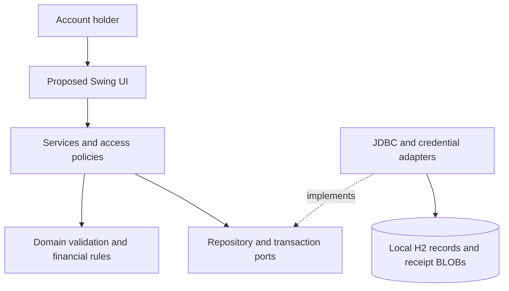

# Architecture #1: Proposed SplitSmart Desktop Architecture

Date: 2026-11-05. Status: proposed, conditional, unimplemented. Gates: [plan.md](plan.md). Business baseline: [spec.md](spec.md).

## Evidence and Scope

The repository supplies customer requirements, consolidated requirements, principles, constitution and specifications. Lab6CIS285.sln is empty. No application sources, executable, schema, deployment or test result were found. Every component below is proposed, including storage, credential handling and notifications. Existing technology choices are distinguished from new decisions in research.md.

This candidate addresses the recorded classroom desktop direction. It does not fulfill primary web/Android/iOS delivery, transfer money, integrate banks, provide external push or claim production readiness. It must not be accepted as full customer fulfillment without U-01's scope decision.

## Components and Responsibilities

| Proposed component | Responsibility | Boundary |
| --- | --- | --- |
| Bootstrap | Load config, open store, apply versioned schema changes, compose adapters/services/UI, close resources | No business calculations; unavailable store gives clear startup failure |
| Swing views/presenters | Account, group, expense, review, balances, payment, report and notice interactions | Input/display only; no SQL, financial calculations or access policy |
| AccountService / SessionContext | Register, login, logout and identify actor | In-process session; credentials never returned in view data |
| GroupService | Create groups, add registered members, query allowed membership | Other management operations await U-05 |
| ExpenseService | Authorize, validate, invoke split rules, save pending expense and associated rows | Creator is default payer; explicit participants only |
| ApprovalService | Apply reviewer policy, verify state/version, atomically approve | Pending expenses have no balance effect; retries cannot approve twice |
| PaymentService | Validate and record permitted settlements | Records payments, never moves external funds; U-07 controls edge cases |
| Domain rules | Money validation, equal/percentage splits, state transitions and balances | Pure Java; independent of Swing/JDBC |
| BalanceQueryService | Derive pairwise debt from approved shares and recorded payments | No independently mutable balance table |
| ReportingService | Read authorized expenses/payments/balances in requested scope | Date semantics and filters depend on U-08 |
| NotificationService | Persist/read proposed in-app notices to other group members | Same-store delivery only; U-06 determines final behavior |
| AccessPolicy / business policy ports | Decide shared-data visibility, reviewer eligibility and operation permission | No invented administrator roles or permissive fallback |
| Repositories / UnitOfWork ports | Load/save records, execute transactional work | Application owns transaction scope; adapters do not choose business policy |
| JDBC/H2 adapters | Parameterized persistence, referential constraints, rollback, optimistic versions | No direct UI access to database |
| Credential adapter | Salted password-verifier creation/verification | Algorithm/parameters and account policy require U-02 |

Dependencies: presentation -> application -> domain and ports; infrastructure implements ports; bootstrap wires implementations. Domain imports neither Swing nor JDBC. One process avoids distributed transactions.



[PlantUML component/deployment source](diagrams/architecture-1.puml) is supplied; rendering has not been verified.

## Data Flow and Transactions

### Account and group flow

UI sends registration credentials to AccountService; the service applies the accepted account policy and saves only a salted verifier. Login creates actor context. Every operation, including reads, checks context and AccessPolicy. Logout clears context and personal views. GroupService creates groups and adds registered users transactionally. No group ownership or administrator permissions are inferred.

### Expense and notification flow

1. Presenter collects amount as decimal text, date, description, group, explicit participants, split method/percentages and optional image.
2. Service authenticates actor, authorizes action and checks group membership; creator is default payer. Override permission is U-05.
3. Domain validates positive amount, distinct nonempty participants and percentage total of exactly 100%; calculate shares using accepted monetary policy.
4. One transaction saves PENDING expense, participant/share snapshots, optional receipt BLOB, and proposed notice rows for other group members. Any failure rolls back everything.
5. After commit, refresh views on the UI thread. Recipients see stored notices when querying the same installation; no remote delivery is implied.

Never show success before commit. U-04 blocks arbitrary residual-cent distribution. U-06/U-09 must settle notice policy and receipt limits before affected implementation.

### Approval flow

Reviewer selects pending expense. ApprovalService authenticates, applies U-03 eligibility policy and reloads record/version. In one transaction, conditionally change PENDING -> APPROVED and record reviewer/time. Update must match pending state and expected version; conflicts prompt reload. Repeated approval produces no second financial effect. Balances read only approved expenses, so no separate balance posting can drift.

### Balance and settlement flow

Proposed accounting convention requiring U-07 acceptance: for approved expense paid by P, participant U other than P owes P its saved share. If P participates, P's share creates no self-debt; if P does not participate, all selected shares are owed to P. Derive signed group-local pair obligations, net opposite directions for display. Do not automatically net different groups.

A recorded payment U -> P reduces that debt. Example: 20.00 owed and 5.00 paid leaves 15.00. PaymentService authenticates, authorizes and checks accepted settlement rules before committing a record. Proposed unique command IDs protect retries. A proposed per-group financial revision prevents stale payment validation when approvals/payments race. Balance/report queries read a consistent transaction snapshot.

Overpayments, self-payments, refunds, corrections, multi-currency and cross-group settlements remain U-07 decisions, not supported behavior. No deletion or reverse-posting workflow is invented.

### Report flow

ReportingService authorizes requested scope, reads records and derives totals in a consistent snapshot. Return tables/summaries with applied selection. Date-filtered activity and balance-as-of reports require different semantics; U-08 must decide. Filtering activity alone must not be mislabeled as a current balance. No export format is promised.

## Technology Choices

| Choice | Provenance | Rationale / consequence |
| --- | --- | --- |
| Java 21, Swing, Maven, JUnit 5, PlantUML, BigDecimal | Existing principles/constitution | Preserve classroom direction; installation and compatibility not verified |
| Layered modular monolith | New ADR-02 | Simple deployment/local transactions, independently testable rules |
| Embedded H2 with JDBC and receipt BLOBs | New ADR-03 | One transactional store; versions, durability configuration and limits require verification |
| Derived balances | New ADR-04 | Avoid mutable totals diverging from approved shares/payments; measure query cost |
| Persisted local notices | New conditional ADR-05 | Possible classroom notification interpretation; no remote service |
| Service authorization/credential ports | New ADR-06 | Central enforcement; final user/security policies remain open |

No web framework, cloud provider, broker, ORM, container platform or mobile stack is selected for this candidate. Exact dependency/plugin versions and licenses must be reviewed and pinned during implementation.

## Deployment Architecture

```text
Workstation / OS account trust boundary
  Java 21 runtime
    one SplitSmart application process
      Swing event dispatch thread: input/display
      background worker: service and storage work
      in-process domain, session and adapters
  private application data directory outside checkout/OneDrive
    local embedded H2 database
      accounts/groups/expenses/shares/receipts/approvals/payments/notices
      schema version and financial revision records
```

Multiple application accounts use the one installation sequentially. Separate installations have independent data and no synchronization. No inbound listener, server, deployed URL or remote collaboration is provided. Do not share the embedded database through network storage or a file-sync service.

Proposed packaging: Maven produces executable JAR with declared runtime dependencies and Main-Class; launch with Java 21. Bundled native installers are deferred. Config and store paths live outside source control. Versioned schema changes run before services start and fail clearly on unsupported versions. Closing drains/cancels background work and closes the store. Transaction failures roll back. Durability settings require testing before crash-recovery claims.

Installation owner controls file access and backups; maintainer owns dependency/schema upgrades. A proposed backup procedure must close the store or use its consistent backup mechanism, then verify restoration. Retention and recovery objectives are unspecified. No RPO/RTO or availability guarantee is made.

Local login does not protect against an OS user who can inspect/change database files. App access checks protect application paths, not a hostile host. Keep credentials, receipt contents and private expense fields out of logs. Proposed local diagnostics use operation/category and correlation ID without sensitive data; no telemetry service is introduced.

### Conditional web/mobile deployment alternative

If CR-10 is retained for the next implementation, revise ADR-01: browser and Android/iOS clients -> authenticated HTTPS interface -> centrally hosted application/domain services -> server-owned relational store and receipt storage. Clients must never access database files directly.

This requires a new network contract, server authorization/session design, TLS, hosting, backup/recovery, network failure and notification delivery design. Server/mobile frameworks and production storage are unselected pending scope approval. A responsive site alone does not establish Android/iOS apps. Domain reuse is a possibility requiring interface/security work, not automatic portability. Desktop-only acceptance must explicitly defer/waive CR-10 in a reviewed requirement decision.

## Integrity, Failure Handling and Quality

- Construct decimal values from text; use fixed-scale storage for money and explicit HALF_UP normalization. Amount range, input precision and percentage bounds require U-04.
- Store final participant shares as snapshots. Proposed membership changes never recalculate approved history; U-05 must accept lifecycle policy.
- Enforce references, unique participant per expense, one approval per expense and unique financial command ID. Cross-row total/percentage invariants require domain validation within transactions.
- Distinguish validation, unauthorized, stale/conflict and storage errors. Return clear messages without SQL details. Roll back the whole logical operation, including image and notices.
- Read reports consistently; serialize or version-check financial writes at group boundary. No distributed lock is proposed.
- Unit tests: exact splits, accepted residual rule, approval isolation and pair balances. Real-H2 tests: constraints, atomic rollback, restart persistence, retries and stale writes. Contract/UI checks: access and visible errors, correct background threading.
- No quality benchmark, accessibility/security compliance or successful test is claimed. Performance targets require U-10.

## Requirement Coverage

All checks are planned, not executed. Baseline stories are in spec.md.

| Requirement | Proposed owner | Planned validation |
| --- | --- | --- |
| FR-001 | AccountService, SessionContext, AccessPolicy | Story 1.1; isolation/logout; U-02 |
| FR-002 | GroupService | Story 1.2 |
| FR-003 | ExpenseService, participant snapshots | Stories 1.3/2.1 |
| FR-004 | ExpenseService, receipt repository/presenter | Story 2.1; optional receipt rollback |
| FR-005 | EqualSplit/PercentageSplit, MonetaryPolicy | Stories 2.2-2.4; U-04 |
| FR-006 | Domain validation, presenter errors | Story 2.5; six invalid categories |
| FR-007 | NotificationService | Story 3.2; U-06 |
| FR-008 | ApprovalService, reviewer policy/version | Stories 3.1/3.3; duplicate approval |
| FR-009 | BalanceQueryService | Stories 3.3/4.1 |
| FR-010 | PaymentService, command IDs/transactions | Story 4.1; retries and rollback |
| FR-011 | ReportingService | Stories 4.2/4.3; U-08 |
| NFR-001 | BigDecimal, split policies, snapshots | Determinism and total preservation |
| NFR-002 | Structured validation and presenter mapping | Clear errors for every invalid category |
| NFR-003 | Service access policies and credentials | Denied cross-account reads/writes; U-02 |
| NFR-004 | Layer boundaries | Domain independent of Swing/JDBC |
| NFR-005 | Traceability and human review | Matrix/review record |
| NFR-006 / CR-10 | ADR-01 and alternative deployment | U-01 scope decision; desktop does not fulfill |

## Decision and Risk Summary

ADR-01: conditional desktop candidate. ADR-02: layered monolith. ADR-03: embedded relational store/transactional images. ADR-04: derived balances. ADR-05: local notices. ADR-06: service access boundary. Full rationale and open decisions: [research.md](research.md).

Principal risks are platform mismatch, implicit permissions, cent allocation ambiguity, local host-file bypass, unclear payment/report semantics, unbounded image/data growth and later migration effort. Controls are explicit gates, reviewed policy tests, decided receipt limits, measurement and isolated adapters. Human review and affected requirement decisions are still required; no full acceptance is claimed.
