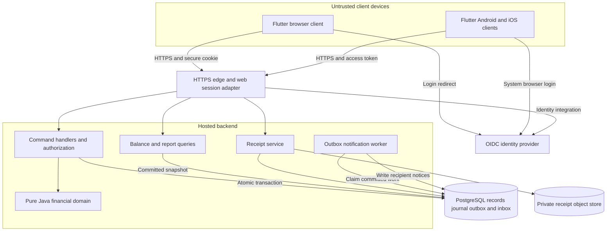
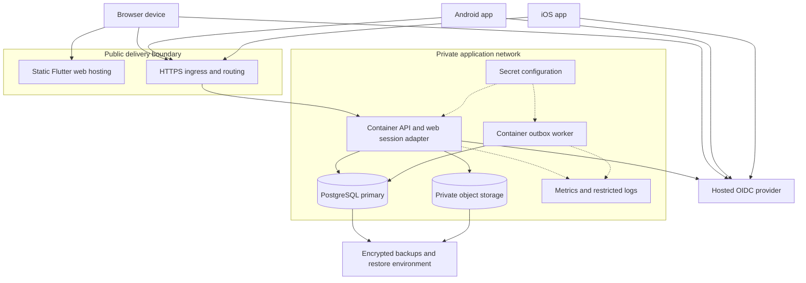

# Architecture #2 — Hosted Client/Server with Financial Journal and Asynchronous Notifications

**Assignment**: CIS 285 Lab 7  
**Date**: 2026-11-05  
**Status**: Independent proposed alternative; unimplemented, pending human review.  
**Baseline**: [spec.md](spec.md). **Comparison**: [Architecture #1](architecture-1.md).

## 1. Evidence and Design Intent

The inspected repository contains requirements, principles, constitution, specifications and architecture/planning documents. Lab6CIS285.sln has no project declarations. No application sources, Maven descriptor, executable, schema, client app, hosted endpoint or application tests were found. Existing design documents describe proposals, not working functionality. No service, provider or database below is currently configured by this project.

Architecture #2 starts from the baseline workflows and prioritizes centrally shared data across browser, Android and iOS clients. It proposes a three-tier client/server system with a separate asynchronous worker, server-owned PostgreSQL, private object storage and an append-only obligation journal. Commands and financial queries are separated logically; financial reads use committed journal data synchronously. This is not full event sourcing or a fleet of microservices.

The change is substantive: clients use a network instead of local calls; the server owns shared transactions and resource access; approval/payments create journal entries; a worker delivers notices; images live outside the relational database; operators manage shared deployment/recovery.

## 2. Desktop versus Web/Mobile Conflict

The customer request and baseline NFR-006 require primary web use plus Android/iOS apps. Recorded engineering choices specify Swing, and the earlier spec excludes full mobile deployment. These statements conflict; none demonstrates delivered support.

**Proposal for this alternative**: web-first delivery plus separately built Android/iOS applications, sharing Flutter presentation code. Retain Java 21, Maven, BigDecimal and domain/UI separation on the backend. Replace Swing with browser/mobile presentation in this candidate. A desktop browser is a client, not a Swing executable.

This requires an explicit reviewed change to the recorded Swing/project-version decision. This document does not amend the constitution, principles or baseline. Scope approval is an implementation gate. A web milestone may demonstrate workflows but cannot be called full CR-10 completion until both mobile targets are built, tested and delivered under agreed distribution criteria. A responsive website alone does not fulfill the apps requirement.

If Swing is mandatory for the course, Architecture #2 remains a comparison alternative. A future Swing API client is possible but additional scope, not assumed. Architecture #1 is preserved.

## 3. Architecture Diagram

Every component shown is proposed.

## 4. Components and Responsibilities

| Proposed component | Responsibility | Boundary |
| --- | --- | --- |
| Flutter clients | Login integration, groups, expense entry, review, balances, payments, reports/notices | Input/display; server validates and computes money. No offline mutation queue or authoritative local balances. |
| HTTPS edge/web session adapter | TLS/routing, limits, browser login callback/session | Browser holds opaque secure cookie, server holds provider tokens; mobile supplies access token. No database exposure. |
| Identity integration | OIDC authentication and app-profile mapping | Provider authenticates; app enforces membership and access. Provider/registration policy undecided. |
| Command handlers | Group/member actions, expense creation, approval, payments | Authorize, validate versions/idempotency, coordinate one transaction. |
| Financial domain | Decimal splits, participation, approval and obligation rules | Pure Java independent of HTTP, UI and storage; missing policy is not replaced by defaults. |
| Journal writer | Post approved shares/payments as immutable signed pair obligations | No pending expense entry; unique source posting prevents duplication. No funds transfer. |
| Query handlers | Personal/group views, pair balances, summaries/date reports | Authorize each read; finance uses committed journal, not eventual cache. |
| Receipt service | Validate bounded uploads, manage private objects/metadata, authorize downloads | Handles cross-store failures; no distributed ACID claim. |
| Outbox worker | Turn committed expense events into durable recipient inbox notices | At-least-once work with duplicate-safe delivery. No push/email provider assumed. |
| PostgreSQL | Operational records, journal, deduplication, web sessions, outbox/inbox | Private, transactional store; controlled migrations. |
| Object store | Receipt bytes under opaque immutable keys | Private access; never user filenames as paths or public buckets. |
| Operations tooling | Releases, secrets, metrics, restricted logs, backup/restore | New responsibilities; no pipeline or monitoring integration exists. |

One backend codebase has request-serving and worker runtime roles. Keep worker work outside request transactions. A broker, Kubernetes cluster and separate service/database per business domain are unnecessary initially; PostgreSQL outbox is the durable work queue.

## 5. Technology Stack

| Layer | Proposed choice | Rationale and limitation |
| --- | --- | --- |
| Clients | Flutter/Dart for web, Android and iOS | Share interactions with separate builds; platform permissions, accessibility, image selection and distribution still require tests. |
| Backend | Java 21, Spring Boot, Spring Security, Maven | Retain documented Java/Maven direction, add HTTP/security framework. Pin compatible supported versions during implementation. |
| Money | BigDecimal with explicit HALF_UP rules | Preserve constitution; JSON money/percentages are decimal strings, not floating-point authority. |
| Persistence | PostgreSQL via Spring JDBC; versioned SQL migrations, proposed Flyway | Central integrity and explicit journal SQL; dependencies require review. |
| Receipts | Private S3-compatible storage behind an interface | Separate image growth from transactional store; adds recovery/cleanup. Provider unselected. |
| Identity | OIDC provider, authorization code with PKCE | Shared identity across targets; provider and enrollment/session/recovery policy require review. |
| Deployment | OCI API/worker containers, static web hosting, private data services | Independent client/server releases; no vendor commitment. |
| Tests | JUnit 5, PostgreSQL integration/API contracts, Flutter tests | Exercise actual store and target platforms; none exists or has run. |

Primary references are in section 15. Suitability is design judgment, not compatibility verification or a benchmark. No untested latest-version claim is made.

## 6. Proposed Database Structure

This is a new logical design, not an existing schema. Use UUID IDs, foreign keys, unique constraints, business dates and technical timestamps. Money uses NUMERIC(p,2); precision/range and accepted input scale need decisions. Percentages are exact decimals with bounds/precision undecided. Domain rejects invalid scale/range before storage instead of relying on implicit database rounding.

| Table | Principal proposed columns | Relationships/constraints |
| --- | --- | --- |
| users | id, identity_issuer, identity_subject, display_name, version | Unique issuer+subject; app stores no provider passwords |
| groups | id, name, created_by, version | Provenance does not imply administrator authority |
| memberships | group_id, user_id, joined_at | Unique pair; registered users only; history/removal unresolved |
| expenses | id, group_id, creator_id, payer_id, amount, business_date, description, split_method, state, version | PENDING/APPROVED only; creator default payer |
| expense_shares | expense_id, participant_id, percentage nullable, allocated_amount | Unique expense/participant, saved share snapshots |
| approvals | expense_id, reviewer_id, approved_at | Unique expense; atomic with approved state/postings |
| payments | id, group_id, from_user_id, to_user_id, amount, business_date, recorded_by | Recorded settlement, not bank transaction |
| journal_batches | id, group_id, source_kind, source_id, recorded_at | Unique source_kind+source_id for approved expense/payment |
| obligation_entries | id, batch_id, pair_low_user_id, pair_high_user_id, signed_delta, currency | Canonical unordered pair, low < high; sum for balance |
| receipts | id, expense_id nullable, uploader_id, intended_group_id, object_key, media_type, byte_count, state, expires_at | STAGED/ATTACHED lifecycle; zero/one attached per expense |
| outbox_events | event_id, event_type, expense_id, recipient_snapshot, state, lease_until, attempt_count | Saved with expense; minimal identifiers, no private image/content |
| inbox_notifications | event_id, recipient_id, expense_id, created_at | Unique event+recipient; read-state policy undecided |
| command_receipts | actor_id, command_id, operation, payload_digest, result_reference | Unique actor+command; identical retry returns authorized original result; altered payload conflicts |
| web_sessions | session_digest, user_id, expiry, protected_token_reference | Shared server session store; protection/expiry policy undecided |
| schema_history | migration_version, execution metadata | Technical schema evolution |

Restrict operational tables to service roles, not public endpoints. Referenced financial history is not cascade-deleted; corrections/deletions require policy before adding operations. Cross-row percentages/share sums need transactional domain checks in addition to foreign keys/uniqueness.

### Journal semantics

This is an append-only pair-obligation journal, not a general bank ledger, full double-entry accounting system or event-sourced application. Operational expense/payment records remain; unique batches record their authoritative posted effects. Reconcile sources and journal routinely.

For canonical pair (L,H), positive balance means L owes H; negative means H owes L. An approved participant U's share owed to payer P adds positive delta when U=L/P=H and negative otherwise. Payer's own share creates no debt entry. Payment reduces its debt-direction delta. Example: L owes H 20.00, then pays 5.00: +20.00 and -5.00, net +15.00.

Candidate scope: group-local netting and one agreed currency; neither is approved yet. No cross-group netting/conversion. Current balances sum entries by group/pair/currency; no mutable balance total initially. Approval/payment, its batch and entries commit together; source reconciliation checks posting amounts. Correction/reversal policy is deferred: append-only storage does not authorize reversals.

Candidate indexes: memberships(user,group), expenses(group,state,date), entries(batch,pair), batches(group), payments(group,date), claimable outbox state/lease, inbox(recipient,created_at). Measure before tuning/partitioning.

## 7. Data Flow and Consistency

### Login/groups

Web redirects through the server adapter to the provider; adapter handles tokens and sets an opaque session cookie. Mobile uses system-browser code flow with PKCE, then sends access tokens. Server validates issuer/audience/signature/expiry and maps issuer+subject to user. Identity authentication grants no membership/reviewer authority. Every operation checks authenticated actor/resource policy; client actor IDs are not trusted.

Group/member commands commit transactionally. Ownership/admin rights, enrollment visibility and removal are unresolved; no role hierarchy is invented.

### Expense and optional receipt

1. Client sends group, decimal amount, date, description, explicit participants, split/percentages and idempotency key. Optional image first uses an authenticated bounded upload endpoint.
2. Receipt service checks content/size, writes immutable private object, then records STAGED metadata bound to uploader/group. If metadata fails, remove/reconcile orphan. Return receipt ID only after upload succeeds.
3. Handler authorizes, checks membership and validates positive/nonblank amount, distinct nonempty participants and exactly 100% percentages. Domain computes total-preserving shares only using an accepted residual policy.
4. One PostgreSQL transaction saves PENDING expense/shares, claims valid unexpired staged receipt, writes command receipt and expense-created outbox event with other-member recipient snapshot. No journal posting. Success follows commit only.
5. Rollback leaves staged objects temporarily reclaimable. Cleanup claims expired STAGED rows under lock/state check before deletion; it must not delete objects concurrently attached to a committed expense. Retry verifies uploader/group and object presence. There is no cross-store atomic transaction.

Receipt limits/retention and recipient timing remain open. Expense without image needs no upload. Downloads check resource policy and stream through service or use short-lived scoped URLs; no public enumeration.

### Approval/payment posting

Approval handler checks accepted reviewer policy/version; lock group financial row then expense in a consistent order. Atomically change PENDING to APPROVED, insert unique journal batch/entries and save command receipt. No approved state without postings; duplicate/concurrent approval returns original authorized result or conflict, never a second financial effect.

Payment handler takes the same group lock, authorizes actor/parties and validates accepted settlement rules against current pair debt. Save payment/batch/entries/command receipt together. Membership/financial operations affecting validation follow lock order and recheck after locking. Deadlock/serialization failure rolls back entire attempt; bounded retry retains idempotency key. These are proposed safeguards, not existing guarantees.

Pending expenses have zero postings. Single approval is preserved. Rejection/edits, refunds, overpayment/self-payment and reversal remain unresolved.

### Notifications/queries

Worker claims committed outbox rows with a lease; inserts recipient inbox notices and marks event processed in one transaction. Unique event+recipient prevents duplicates; expired work retries after crash. Persistent failures retain retry/error metadata and alert operators. No exactly-once transport or delivery deadline promised. Recheck current recipient permissions before revealing expense details if membership changed.

Clients query server inbox, allowing different devices to see notices. This proposed channel is in-app, not push/email. Worker lag never alters financial totals. Worker failure delays notices; financial commands can continue subject to backlog controls.

Balances query primary committed journal immediately after successful write. Multi-query reports use a consistent snapshot; no eventual financial projection. Activity date versus current/as-of balance, approval versus expense time and date inclusivity require decisions. Do not arbitrarily filter posting timestamps and claim correct history.

## 8. Deployment Diagram and Strategy

**Classroom candidate**: static web build, one API container, one worker container, PostgreSQL and S3-compatible storage on a development machine or small hosted environment. A test identity provider is another dependency. Local containers do not prove internet access or safe production hosting. No infrastructure files/accounts are created here.

**Shared hosted candidate**: same-origin web and /api behind HTTPS ingress; static assets released separately from API/worker; PostgreSQL private, receipts nonpublic, secrets injected externally. Mobile binaries use the same authenticated API. Hosting provider/region and data location await budget/privacy review. One API instance and database primary suffice for evaluation; extra replicas are options, not initial requirements.

Proposed pipeline: backend tests/package, client target tests/builds, dependency checks and signed/versioned artifacts; controlled reviewed database migrations; compatible API/worker/static releases. Mobile needs platform signing/testing/distribution and possibly store review. iOS requires the appropriate Apple toolchain, not just this Windows workspace. No working pipeline or approved app is claimed.

Maintainer owns releases/migrations; operator owns secrets/alerts/backups; requirement owner approves policies. Back up database, receipt objects and configuration using a consistent recovery procedure; verify attached object references after restore. A database-only backup is insufficient. Define recovery targets, retention and restore permission before release; no RPO/RTO is established.

## 9. Security and Trust Boundaries

All controls below are proposed and require verification.

- Clients are untrusted. Server computes shares, checks reviewers, records payments and authorizes report scope. UI visibility is never authorization.
- Use HTTPS, provider login, restricted administrator access, least-privilege API/worker/database/object credentials, secret rotation and safe deployment configuration. Provider and account recovery/enrollment remain decisions.
- Web adapter keeps provider tokens server-side; use Secure/HttpOnly/SameSite session cookies, CSRF protection on cookie-authenticated mutations, session rotation and logout invalidation. Mobile uses PKCE, OS-protected token storage and reviewed token lifetime/revocation controls. No client secret in mobile builds or browser local storage.
- Check resource permissions on every ID lookup, command, report and receipt download. Group-based visibility remains subject to the baseline private/shared-data decision; fail closed when undefined.
- Parameterize SQL, validate request schemas and image content, bound uploads, use opaque object keys and safe download responses. Logs exclude tokens, image bytes and private expense descriptions.
- Rate-limit identity-related and expensive/upload endpoints; cap pagination/report breadth after policy review. No arbitrary value is claimed as an existing requirement.
- Protect backups and network/storage paths; decide who can restore. Central hosting removes end users' direct database-file access but increases backend-compromise impact and operator trust.
- Append-only journal is an application integrity rule, not tamper-proof evidence. Restrict update/delete privileges and reconcile sources. Database administrators remain trusted. No compliance certification or invented production role hierarchy.

## 10. Scalability and Availability

API replicas share server-side sessions and command receipts; mobile token validation does not require process-local login state. Scale replicas from measured latency/errors/utilization, not invented user counts. Worker replicas claim distinct leased events; monitor backlog age, retry rate and failed work.

PostgreSQL is the initial bottleneck/failure domain. Keep transactions short, index authorized queries and bound reports. Per-group financial serialization limits one busy group's write throughput but preserves validation; different groups proceed concurrently. Separate object storage avoids database image growth, but upload validation/server resources still require bounds.

Measure before adding caches, replicas, partitions or brokers. Future finance on read replicas requires freshness guarantees; initial financial reads use primary. An asynchronous report projection is optional future design, not part of the correctness path.

Database failure prevents authoritative reads/writes; show unavailable status instead of accepting offline money changes. Object-store failure blocks receipt operations but need not block expenses without images. Identity failure may block login/refresh; still-valid session behavior depends on policy. Worker failure delays notices and alerts operators. Request timeout leaves outcome uncertain; retry the same command key or query status instead of submitting a new payment.

No throughput, uptime, latency or recovery guarantee is measured. Scaling API replicas does not remove database/identity/storage dependency. Multi-region deployment and offline synchronization are excluded.

## 11. Maintainability and Verification

Proposed organization: backend modules for identity/groups, expense/approval commands, pure domain/journal, authorized queries, receipts and notifications; client features mirror user workflows. Versioned API schemas define decimal strings, dates, command IDs, expected versions and safe errors. These are proposed structures, not directories found in the repo.

API and worker entry points reuse domain code/migrations. Enforce domain independence from HTTP/persistence/UI. Evolve contracts compatibly because installed mobile clients may lag server releases. Pin dependencies and review updates. No code/build/test files are created here.

Planned tests: baseline equal/percentage examples, accepted residual rule, six invalid categories, pending isolation, unique approval postings, 20.00 minus 5.00 settlement, concurrent retries/rollback, worker crash/replay, receipt attachment/cleanup race, denied cross-account access, report dates, backup/restore and cross-device views. Use PostgreSQL integration tests, not assumed embedded-store equivalence; exercise web and both mobile targets. Accessibility/responsiveness criteria require agreement. No application tests have run for this proposal.

## 12. Requirements Coverage

| Requirement | Proposed responsibility | Acceptance focus |
| --- | --- | --- |
| FR-001 | OIDC/app users/access policies | Personal access, unrelated data denied |
| FR-002 | Group/membership commands | Create group, add registered users |
| FR-003 | Expense command/share snapshots | Default payer, explicit subset |
| FR-004 | Expense records/private receipts | Required fields, optional image |
| FR-005 | Java split domain | Equal/percentage shares, exact total |
| FR-006 | Domain validation/client errors | Six documented invalid categories |
| FR-007 | Outbox, worker, recipient inbox | Post-commit notice, replay safe |
| FR-008 | Approval command/atomic posting | Single approval, pending zero effect |
| FR-009 | Journal balance queries | Correct approved pair debt |
| FR-010 | Payment command/journal batch | Record once, update remaining debt |
| FR-011 | Snapshot report queries | Authorized summaries/date selection |
| NFR-001 | BigDecimal/exact storage/posting | Deterministic totals/source reconciliation |
| NFR-002 | Structured field errors | Clear rejection before save |
| NFR-003 | Server identity/resource checks | Shared/private policy approval needed |
| NFR-004 | Thin clients/domain separation | Financial rules separate from UI |
| NFR-005 | Matrix, decisions, future tests | Traceability and human acceptance |
| NFR-006 / CR-10 | Web plus Android/iOS builds | Better alignment, pending Swing revision and actual delivery |

## 13. Assumptions and Unresolved Decisions

Baseline remains authoritative; existing research.md register is not overwritten. Block affected implementation until decisions are recorded.

| Issue | Architecture #2 candidate or limit | Decision required |
| --- | --- | --- |
| Platform | Prioritize web/mobile, conditionally replace Swing | Customer/course approval of direction/staged acceptance |
| Identity/privacy | Provider authentication, backend access checks | Enrollment/identifiers/sessions and exact personal/shared visibility |
| Review | One approval, no invented roles | Reviewer eligibility, self-approval, rejection/changes |
| Money | Half-up cents/exact total | Residual allocation, amount limits/precision and percentage bounds |
| Currency/payment | One currency/group-local pairs candidate | Recording permission, overpay/self-pay/refund/correction/netting |
| History | Candidate immutable approved shares | Membership changes, payer override, expense edits/deletion |
| Notices | Asynchronous server inbox | Recipient timing, channel, read-state/failure expectations |
| Reports | Consistent committed snapshots | Filters, date inclusivity, business/posting time, as-of meaning |
| Receipts/operations | Private objects/staged attachment | Image limits/formats/retention, recovery targets, data location |
| Quality/distribution | Online clients, no production SLA | Capacity/accessibility, supported OS/browser, cost and mobile delivery |

Missing policy produces a development gate, not an arbitrary production default. This is a complete alternative proposal, not implementation readiness or a requirement amendment.

## 14. Differences from Architecture #1 and Tradeoffs

| Concern | Architecture #1 | Architecture #2 |
| --- | --- | --- |
| Style | Local desktop layered monolith | Networked three-tier plus asynchronous worker |
| UI | Swing workstation | Flutter web/Android/iOS target builds |
| Shared data | Embedded H2 per installation | Central PostgreSQL shared across authorized devices |
| Financial source | Query approved shares/payments directly | Atomic obligation journal linked to source records |
| Notifications | Local records in expense transaction | Outbox and separate worker deliver server inbox |
| Images | Database BLOBs | Private objects plus staged metadata/cleanup |
| Trust boundary | Local OS/database files | Untrusted clients, central service/data control |
| Deployment | Runtime/JAR/local data | Web assets, API/worker, identity, database/object services |
| Cost | Simple setup, limited sharing | Hosting/network/security and operational complexity |
| Conflict | Preserves Swing, leaves CR-10 unmet | Targets CR-10, requires reviewed Swing change |

Benefits: shared-data deployment, browser/mobile path, central authorization, independent notice processing and inspectable financial postings. Costs: network dependence, more components, cross-store recovery, eventual notice visibility, identity operations, mobile releases and greater classroom workload. Journal effects duplicate information from source records, requiring atomic linkage and reconciliation.

A simpler hosted backend without journal/worker would reduce effort; this alternative chooses them to make posted financial history and asynchronous delivery explicit. Full microservices/event sourcing would add deployment/consistency costs without a requirement. Architecture #1 suits a constrained local demonstration; Architecture #2 is a candidate when shared web/mobile access takes priority and extra work is accepted.

## 15. Technical References

Repository evidence: [baseline](spec.md), [Architecture #1](architecture-1.md), [decision register](research.md), [customer requirements](../../UserRequirement.md), [consolidated requirements](../../requirements.md), [principles](../../SplitSmartPrinciples.md), [constitution](../../.specify/memory/constitution.md), [solution](../../Lab6CIS285.sln). These establish documented intent, not implemented components.

Primary references checked for technical capabilities:

- [Flutter platform integration](https://docs.flutter.dev/platform-integration) and [web support](https://docs.flutter.dev/platform-integration/web): target capabilities; individual delivery/testing still necessary.
- [Spring Boot OAuth2](https://docs.spring.io/spring-boot/reference/security/oauth2.html) and [Spring Security JWT resource server](https://docs.spring.io/spring-security/reference/servlet/oauth2/resource-server/jwt.html): proposed identity integration, not an existing configured provider.
- [PostgreSQL numeric types](https://www.postgresql.org/docs/current/datatype-numeric.html): exact decimal storage; domain still defines monetary rules.
- [PostgreSQL isolation](https://www.postgresql.org/docs/current/transaction-iso.html) and [locking](https://www.postgresql.org/docs/current/explicit-locking.html): concurrency references, not verification of future implementation.

No dependencies installed, deployment created, Mermaid rendering verified, benchmark run or application acceptance executed during this documentation task.
