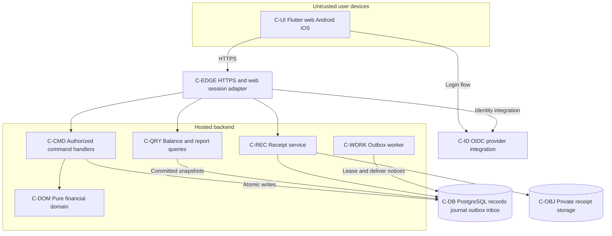
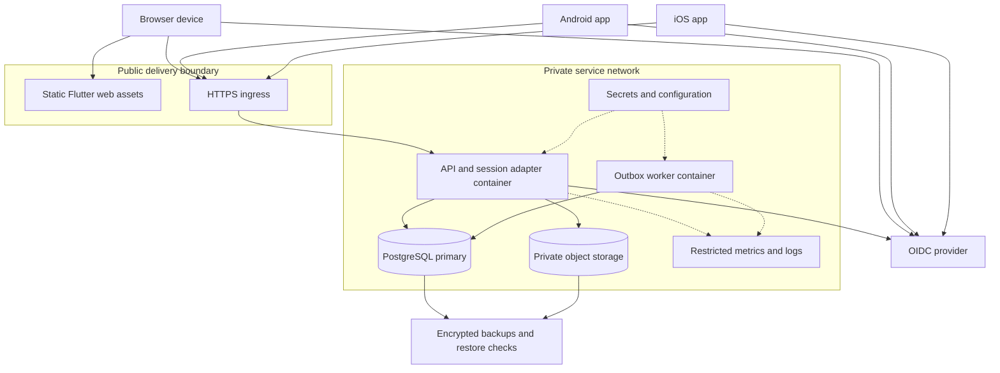

# Consolidated Architecture — Selected Architecture #2

Date: 2026-11-05. Status: student-selected design, unimplemented; G-01 scope approval open. [Index](README.md), [ADR](architecture-decision-record.md), [requirements](consolidated-requirements.md), [design](consolidated-design.md), [validation](consolidated-validation.md).

## System style and technology

Three-tier networked clients/server with a separate asynchronous worker. Flutter browser/Android/iOS presentation sends authenticated HTTPS requests to Java 21/Spring Boot services and pure BigDecimal domain rules. PostgreSQL stores operational records, append-only pair-obligation journal, command receipts, sessions, outbox and inbox. Private S3-compatible objects store images. OIDC integrates authentication; app controls resource access. One backend codebase has API and worker runtime roles; no full microservice fleet, broker or event sourcing is required.

Java 21, Maven, JUnit 5, decimal money and separation are inherited project choices. Flutter/Spring/Spring Security/PostgreSQL/object store/OIDC and proposed Flyway schema migrations are selected-design technology proposals requiring dependency/provider/version confirmation. The prior Swing choice is explicitly G-01, not silently replaced. No library, endpoint, schema, pipeline or deployment exists as a result of this document.

## Components and responsibilities

| Component ID | Responsibility | Boundary |
| --- | --- | --- |
| C-UI | Flutter web/Android/iOS screens, input/error display and platform integration | No authoritative financial calculation, offline mutation queue or trusted actor ID |
| C-EDGE | HTTPS ingress/routing and web session adapter | Browser secure cookie, server-held provider tokens; mobile bearer token; no database access from clients |
| C-ID | OIDC integration, issuer/subject mapping to UserAccount | Authentication does not grant group/reviewer permissions; provider/registration policies G-02 |
| C-CMD | Group, expense, approval and payment commands | Resource authorization, validation, versions, idempotency and transaction coordination |
| C-DOM | Pure financial/membership/approval policies and journal builder | No HTTP/Flutter/JDBC dependencies; policy gates stay explicit |
| C-QRY | Authorized expense/balance/report queries | Committed primary journal for finance, consistent snapshots; no stale projection as authority |
| C-REC | Receipt upload, metadata, authorized access and cleanup | Private objects; explicit cross-store recovery |
| C-WORK | Lease/retry outbox and create recipient inbox notices | At-least-once work, duplicate-safe delivery; no external push/email |
| C-DB | PostgreSQL records, journal, sessions, deduplication/outbox/inbox | Transactions, constraints, private service access, controlled migrations |
| C-OBJ | Private receipt bytes under immutable opaque keys | No public bucket or user-supplied object paths |
| C-OPS | Secrets, restricted metrics/logs, backups and release operations | Operator responsibilities proposed; no configured service inferred |

## Component diagram

Mermaid component view: boxes are software components, cylinders data stores; arrows show proposed communication, not existing code.

## Data flow and consistency

1. **Identity/groups**: Web adapter handles provider callback, creates opaque secure session; mobile uses system-browser code flow with PKCE. Server maps validated identity to app user and checks resource policy on every command/query. Group creation/addition uses registered users, with rights defined by G-02/G-05.
2. **Expense**: Authenticate/authorize, validate fields and participant membership; apply accepted splitting policy. One database transaction commits PENDING expense/shares, optional staged receipt attachment, command receipt and recipient-snapshot outbox event. Pending creates no financial postings. Return success only after commit. G-04 blocks uneven split tie-breaking.
3. **Receipt**: Validate/upload private immutable object, record STAGED metadata bound to actor/group. Expense transaction claims eligible staged object. Cleanup locks/claims expired stage before deletion and must not race attachment. Object storage/database lack shared ACID; orphan reconciliation and restore checks are required.
4. **Approval**: Check accepted reviewer policy and expected version; lock group then expense. Atomically approve, insert unique journal source batch/entries, and command result. No approved state without posting, no duplicate posting. Pending remains financially isolated.
5. **Payment**: Check actor/parties and accepted settlement policy against current committed debt under the same group lock. Atomically save recorded payment, signed journal batch and command result. Records do not move funds.
6. **Notice**: Worker claims committed outbox lease, inserts recipient inbox rows and completes event transactionally; unique event/recipient key handles retries. Expired lease retries after crash; persistent failures alert operators. Notices can lag without delaying already committed finance. Current access is rechecked before revealing expense detail.
7. **Read/report**: Authorize scope and read primary journal/records consistently. No eventual financial projection or replica freshness assumption. G-08 defines activity versus current/as-of date meaning.

Errors distinguish validation, unauthenticated, forbidden, not-found, stale/conflict, unresolved policy, storage/service unavailable. Error bodies contain safe messages/field details/correlation IDs, not SQL, tokens or private object keys. Idempotent retries use same actor/command/payload; changed payload conflicts. Network timeout is uncertain outcome, not proof failure. Bounded transaction retries retain command identity. Request cancellation must not imply committed payment reversal.

## Trust boundaries and security

Untrusted clients cannot access DB/object administration. HTTPS edge reaches private API; server validates identity and access, including receipt/report queries. Browser sessions use Secure/HttpOnly/SameSite cookies plus CSRF protection for cookie mutations; provider tokens stay server-side. Mobile uses reviewed token storage/expiry policies. No provider secret ships in clients. Final access/enrollment/session/reviewer policies remain G-02/G-03.

Parameterized SQL, schema validation, file content checks, bounded uploads/queries, least-privilege service roles and restricted administrator access are proposed controls. Secrets stay outside source control. Logs exclude tokens, receipt content and private descriptions. Append-only journal is application integrity, not tamper-proof accounting: administrators remain trusted, sources reconciled. No compliance/security certification is claimed.

## Deployment diagram

Classroom evaluation can use local containers and static assets; that is not delivered hosted availability. Hosted target uses static web hosting, one initial API container, one worker, private PostgreSQL and objects; mobile binaries connect to same API. Providers/region/budget and versions remain G-10. Clients never connect to database files. Android/iOS require separate builds/signing/testing/distribution; iOS needs its platform toolchain. No installation or store approval is evidenced.

Pipeline proposal: domain/API/store/client tests, pinned dependency builds and signed artifacts, controlled backward-compatible migrations, API/worker and web releases, compatible support for older installed mobile clients. Maintain release rollback and restore procedures without promising irreversible schema rollback. Operator backs up DB plus objects/config and verifies recoverability of attached receipt references. RPO/RTO/retention and operational thresholds require G-09/G-10.

## Scaling, failure and maintainability

API instances can share server sessions and deduplication; worker replicas claim different leases. Measure latency/errors, worker lag, DB utilization and bounded reports before scaling. Group-level financial locks serialize busy-group writes; independent groups can proceed. DB remains initial bottleneck/failure domain. Avoid brokers, partitions, read replicas and caches until justified; finance initially uses primary for read-after-commit visibility.

DB outage prevents authoritative finance. Object outage blocks image operations but not necessarily image-free expenses. Identity outage affects login/refresh under approved session rules. Worker outage delays inbox delivery with retry/backlog alerts. No offline financial writes, multi-region guarantees or numeric SLA is added.

Keep pure domain, commands, queries, identity, receipts and notice modules separated; version API schema and DB migrations together. Use PostgreSQL integration tests, not assumed H2 equivalence. Requirements/component/test mapping lives in [validation](consolidated-validation.md). [ADR](architecture-decision-record.md) retains all tradeoffs and approval gates; these diagrams do not imply implemented functionality.
