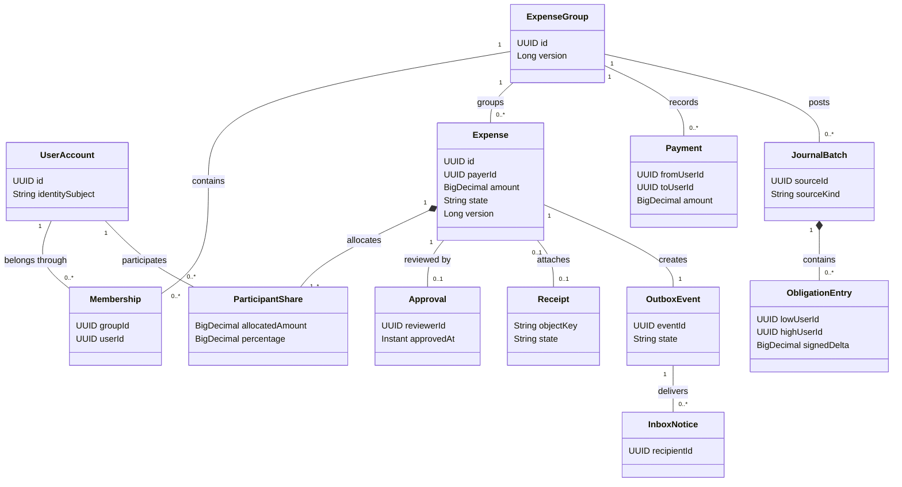
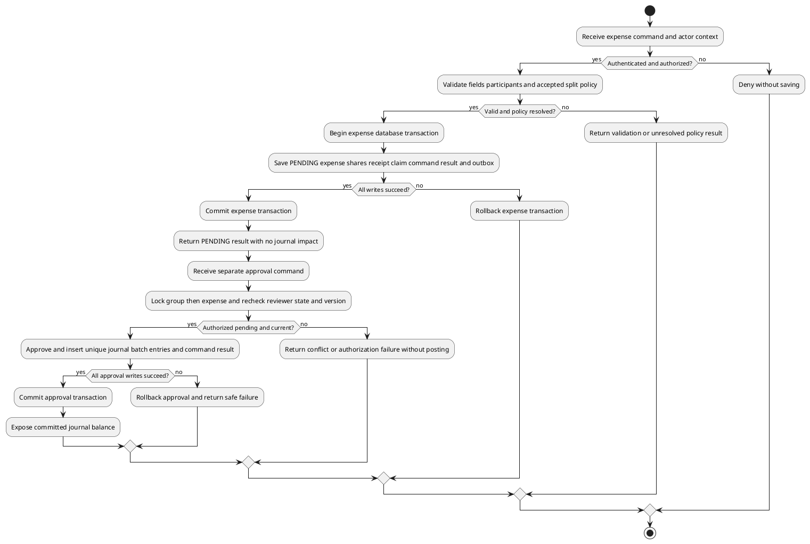
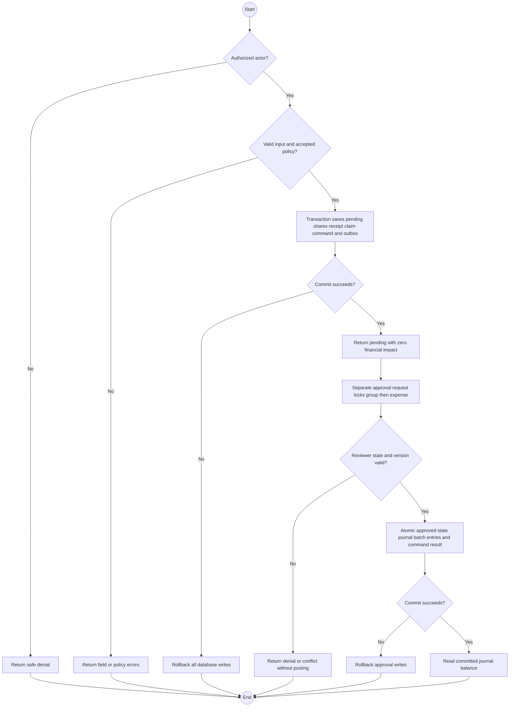

# Consolidated Design — Selected Architecture #2

Date: 2026-11-05. Status: proposed logical design, unimplemented. [Index](README.md), [architecture](consolidated-architecture.md), [requirements](consolidated-requirements.md), [ADR gates](architecture-decision-record.md), [validation](consolidated-validation.md). Types/fields below are proposed, not existing classes/schema.

## Domain and storage model

UUID identifiers; business dates separated from technical timestamps. Java BigDecimal and SQL exact NUMERIC money; decimal string transport. Precision/range/currency and residual policy remain G-04/G-07. Group membership is not expense participation. Creator is default payer, not automatically reviewer/admin. Approved shares are proposed immutable snapshots; edits/history need G-05.

| Logical class / proposed table | Key fields and relation | Invariant |
| --- | --- | --- |
| UserAccount / users | id, identityIssuer, identitySubject, displayName | Unique issuer/subject; provider passwords absent |
| ExpenseGroup / groups | id, name, createdBy, version | Creator records provenance, not automatic permission |
| Membership / memberships | groupId, userId, joinedAt | Unique group/user; lifecycle G-05 |
| Expense / expenses | id, groupId, creatorId, payerId, amount, businessDate, description, splitMethod, state, version | PENDING initially, one group, explicit shares |
| ParticipantShare / expense_shares | expenseId, userId, percentage optional, allocatedAmount | Unique expense/user, percentages total 100 if used; allocations total expense |
| Approval / approvals | expenseId, reviewerId, approvedAt | Zero/one, atomic with state/posting |
| Payment / payments | id, groupId, fromUserId, toUserId, amount, date, recordedBy | Recorded settlement only; G-07 limits/exceptions |
| JournalBatch / journal_batches | id, groupId, sourceKind, sourceId, recordedAt | Unique source kind/id; approved expense or payment |
| ObligationEntry / obligation_entries | batchId, lowUserId, highUserId, signedDelta, currency | Canonical pair low < high; zero entries allowed for all-self share |
| Receipt / receipts | id, expenseId optional, uploaderId, intendedGroupId, objectKey, state, expiry, content metadata | STAGED/ATTACHED, zero/one attached image per expense |
| OutboxEvent / outbox_events | id, expenseId, recipientSnapshot, state, lease, attempts | Committed with expense, durable retries |
| InboxNotice / inbox_notifications | eventId, recipientId, expenseId, createdAt | Unique event/recipient; content access rechecked |
| CommandReceipt / command_receipts | actorId, commandId, operation, payloadDigest, resultRef | Unique actor/command; replay consistency |

Technical web sessions/schema-history tables follow Architecture #2. BalanceView/ReportView are immutable query results, not mutable money records. Foreign keys restrict deletion of referenced history; no automatic deletion policy is invented.

## UML class diagram

Logical UML class relationships in Mermaid; not reverse-engineered code.

Each staged Receipt may have no Expense; an Expense has zero/one Receipt. JournalBatch source reference is validated by source kind/id and transactional writer; DB polymorphic source references alone do not enforce the source exists. Expense may have zero/one batch (zero while pending); Payment has exactly one committed batch. These conditional rules are stated rather than misleadingly requiring posting for pending expense.

## Interfaces and safe outcomes

Proposed versioned HTTPS contracts, not configured routes. Actor comes from session/token. Money/percentages are decimal strings, dates explicit business dates. All mutations enforce authorization; reads enforce scope as well.

| Use case | Required input | Successful result | Principal gates |
| --- | --- | --- | --- |
| Register/login/logout | Reviewed provider enrollment/login/session flow | App identity/session; no provider secret returned | G-02 |
| CreateGroup/AddMember | Group data or registered user/group IDs, version | Authorized group/membership view | G-02/G-05 |
| CreateExpense | Command key, group, amount/date/description, explicit users, method/percentages, optional staged receipt ID | Committed PENDING view, shares/version | G-04/G-05/G-09 |
| ApproveExpense | Command key, expense ID, expected version | APPROVED result and one source posting | G-03 |
| RecordPayment | Command key, group/from/to/amount/date | Payment ID and committed financial reference | G-07 |
| GetBalances/GetExpense | Authorized group/personal scope/ID | Authorized immutable view and snapshot | G-02/G-07 |
| GenerateReport | Scope, dates, accepted filters | Selection/rows/totals/snapshot meaning | G-08 |
| Stage/GetReceipt | Authenticated image upload or expense/receipt ID | Staged ID or authorized bytes/scoped access | G-09 |
| ListNotices | Actor context, bounded selection | Actor's permitted server inbox notices | G-06 |

Safe result categories: validation, unauthenticated, forbidden, not-found, conflict/stale, unresolved-policy, storage/unavailable. Final HTTP codes/payload names are contract-finalization work; do not pretend an OpenAPI implementation exists. Mutations return success only after commit; no SQL/token/private key leakage. Unauthorized ID existence disclosure requires G-02. Idempotency matches actor/key/operation/payload digest; identical retry returns original authorized result, altered payload conflicts. Retry authorization is rechecked. Retention of command receipts is an operational decision; never expire protection while duplicate submissions remain possible without a documented strategy.

## Transaction and journal invariants

- Validate the six baseline invalid categories before saving. Exact 100% and total-preserving half-up cent shares are required. No arbitrary residual recipient: G-04.
- Expense transaction commits PENDING record/shares, optional receipt claim, command receipt and outbox recipient snapshot together. No pending journal entries.
- Approval transaction takes group lock then expense lock, rechecks reviewer/state/version, updates state, inserts unique batch/entries and command outcome atomically. Duplicate approval cannot post again.
- Payment transaction follows group lock order, validates current debt and accepted payment policy, inserts payment/batch/entries/command outcome. Membership changes affecting validation follow compatible locking. Bounded deadlock/serialization retries use same key.
- Canonical pair (L,H): positive means L owes H, negative H owes L. Approved share creates sign according to participant->payer; payer's own share no debt. Payment reduces debt-direction sign. +20.00 expense debt then -5.00 recorded settlement gives +15.00. Group-local/currency scope is G-07, not assumed product approval.
- Unique source kind/id prevents duplicate batch. Journal/source reconciliation detects mismatch. Query committed journal for finance, consistent snapshot for multi-query report. No eventually consistent balance cache.
- No deletion/reversal/rejection workflow is added. Append-only journal is not full double-entry accounting, event sourcing or bank transfer.

## UML activity diagram — create, approve and post

PlantUML activity source preserves the original diagram-tool direction without modifying it. Every activity is proposed; diagram rendering status is recorded in validation.

A presentation-friendly activity view in Mermaid uses decisions and start/end nodes; PlantUML above is the UML activity source.

## Receipt and notification lifecycle

Receipt upload checks approved size/content, writes private immutable object and STAGED actor/group metadata; compensate/reconcile orphan if metadata fails. Expense transaction locks stage, checks ownership/group/expiry/object presence and attaches once. Cleaner first claims expired STAGED row with state lock; attachment and cleanup cannot both win. Database rollback does not roll back object writes. Backups restore metadata plus referenced objects; secure deletion/retention G-09.

Outbox transaction captures event/recipient IDs with expense, not private image/description. Worker leases committed event, transactionally inserts inbox notices and completes event. Unique event/recipient handles retry after crash; lease expiry reclaims work. Failed attempts back off and alert after reviewed operational threshold. Query rechecks recipient authorization before disclosing expense details after membership changes. Delivery lag is not financial lag; no push/email or read-state policy silently added.

AccessPolicy, ReviewerPolicy, SplitPolicy, PaymentPolicy and ReportPolicy isolate G-02..G-08 decisions from UI/storage. No policy means no implementation of that affected path until clarified. Unimplemented components/classes, incomplete business policies and unexecuted validation remain explicit throughout this set.
